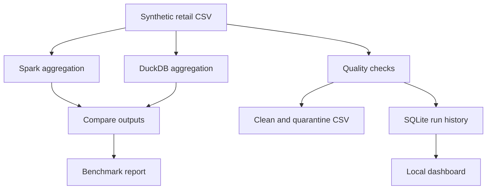

# Retail Data Engineering Portfolio

Three connected, independent learning projects inspired by public descriptions of retail data engineering challenges. Synthetic data only; this is not a Cognira project, does not use Cognira systems and is not endorsed by Cognira.

1. **Migration** — equivalent Spark and DuckDB daily store aggregations with exact output comparison.
2. **Benchmark** — repeated cold-process runs, alternating order, elapsed time and sampled process-tree peak RSS, with correctness gates.
3. **Quality monitoring** — validates records, quarantines rejects, records run history in SQLite and serves a local dashboard.

## Requirements

Python 3.10–3.11, Java 17, 4 GB available memory recommended for local Spark, Linux/macOS. Docker is optional. No cloud account or data download is required. On low-memory machines, keep benchmark datasets small and run one job at a time.

```bash
python3 -m venv .venv
source .venv/bin/activate
python -m pip install -r requirements.txt
python generate_data.py --rows 10000 --output output/sales.csv
python -m migration.run --input output/sales.csv --engine compare
python -m benchmark.run --sizes 1000 10000 --repeats 2
python generate_data.py --rows 1000 --dirty --output output/dirty.csv
python -m quality.run --input output/dirty.csv
python -m quality.dashboard
```

Open http://127.0.0.1:8080. The dashboard is intended for local use only. To make quality issues fail a scheduler/CI step, add `--fail-on-rejected`; it returns exit code 2 when rows are rejected. Quality output filenames are overwritten on each run; SQLite retains summaries.

Run `python -m unittest discover -s tests -v`. Spark and DuckDB tests are skipped if dependencies are absent; install all requirements to exercise them. Or `docker build -t retail-data-portfolio . && docker run --rm retail-data-portfolio`.

## Architecture



## Data contract

One row per sale: integer `sale_id`, ISO `sale_date`, positive `store_id`, `product_id`, `quantity` and `unit_price_cents`. Revenue is calculated in integer cents. The migration pipeline expects valid contract-compliant data; use quality checks first for external data. The comparison checks grouped results, not individual source rows. The quality project treats repeated IDs as duplicates in input order; an invalid earlier record can still cause a later record with the same ID to be rejected.

## Benchmark interpretation

The benchmark includes startup, reading, aggregation, collecting and writing results; it is a local experiment, not a distributed-cluster test. Memory is the maximum sampled sum of process RSS and may miss short peaks or double-count shared memory. Alternating order does not eliminate filesystem cache effects. Compare repeated measurements on the same machine; no cost savings or universal performance claims are implied. The benchmark writes measurements, not an automated engine-selection policy.

## Project layout

- `generate_data.py`: deterministic input generator.
- `migration/`: equivalent transformations and CLI.
- `benchmark/`: subprocess benchmark and CSV/JSON results.
- `quality/`: validation, quarantine, run history and local dashboard.
- `tests/`: determinism, quality, known result and cross-engine comparison.
- `.github/workflows/ci.yml`: Java/Python setup and tests.

## Limitations

This is an educational local prototype: no cloud deployment, distributed Spark cluster, streaming, authentication, alert delivery, Databricks integration, managed scheduling, transactional output writes, or production-grade schema evolution. Monitoring uses local SQLite and the Python standard library. Dependencies are bounded rather than locked; pin them for reproducible production deployment. Do not expose the dashboard to the public network.
